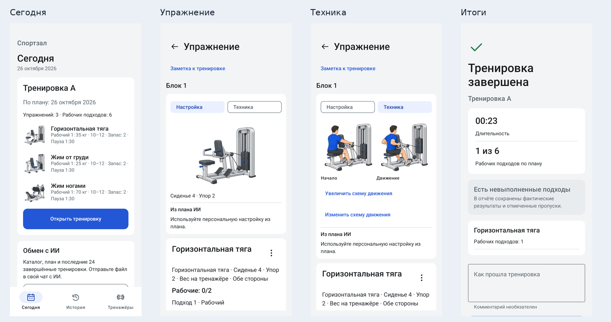

# Проверка Sportzal 0.2.0

База: main 92089d5, включает PR41. Реализация находится в [PR #42](https://github.com/bimjim225-ship-it/sportzal/pull/42); main не изменялся.

## Результат

Реализован основной офлайн-цикл: каталог зала → JSON-план от внешнего ИИ → предпросмотр без запуска → явное начало → обзор и выбранное упражнение → запись факта → итог и JSON-отчёт для следующего плана. Новый импорт не меняет snapshot уже начатого занятия.

Схема оборудования и техника движения назначаются отдельно. Встроены пять типовых схем, по две позы движения и масштабирование. Фото доступно в разделе исходника. Поиск, просмотр и редактирование тренажёра разделены; настройки и доступные веса сохраняются атомарно.

Скриншоты получены инструментальным тестом на API30, 360×800 dp, с синтетическими данными. Это интерфейс Compose, не дизайн-макет. [Сегодня](screens/01-today.png), [план](screens/02-plan.png), [обзор](screens/03-workout.png), [настройка](screens/04-setup.png), [техника](screens/05-technique.png), [импорт](screens/06-import.png), [итог](screens/07-finish.png), [история](screens/08-history.png), [каталог](screens/09-catalog.png), [тренажёр](screens/10-equipment.png).

## Проверки

| Проверка | Результат |
|---|---|
| Unit tests | 107/107, 0 failures/errors |
| Полный Android suite, API30 | 73/73, включая Room, Compose и файловый обмен |
| Room migrations | Подлинная схема v1 экспортирована до изменения entities; v1→2 и v1→3 проходят, данные сохраняются |
| Debug APK и test APK | Собраны; ZIP CRC и подпись APK проверены |
| Android lint | 0 errors, 26 warnings: доступные обновления зависимостей, зарезервированные ресурсы, имя test composable и исходная launcher icon |
| Графика | 25 WebP + 24 VectorDrawable совпадают с контрольными суммами пакета |
| Документация | 2 схемы, 6 положительных и 25 отрицательных примеров, ссылки/YAML, 9 пар контраста — PASS |
| Premium static audit | 0 findings; документный сканер, не проверка Kotlin runtime |
| Design context lint | 0 errors, 11 предупреждений о ссылках на токены; runtime использует единый Compose adapter |
| GitHub CI | Build/unit/lint/docs/resources и матрица инструментальных тестов API30/API35; актуальные результаты во вкладке Checks у PR |

Подтверждены: ввод 22,5; явный ответ «Не оценил» и числовой RIR; Back/continue и пересоздание Activity; отмена пустого запуска; дополнительный подход после последнего планового; замена фактического оборудования; отдельные счётчики warmup/extra/skips; ошибка открытия с Retry/Back; поиск и отдельный editor; сохранение/отправка JSON; импорт следующей версии во время активного занятия и сохранение его фактов.

Проверены доступность управления при 320 dp/200% шрифта и размещение над системными панелями/клавиатурой. В CI на 320×640 dp обнаружились обращения тестов к ещё не размещённым элементам LazyColumn. Тесты прокручивают контейнер до целевого элемента и проверяют видимость перед нажатием. Assertions записи факта и неизменности активного плана сохранены.

## Независимое ревью

Исправлены существенные замечания: контекст схем после завершения упражнения возвращался к плану; намеренные null-настройки могли заменяться плановыми; дополнительный подход был недоступен после последнего слота. Общий контекст теперь выбирается целиком: draft → последний факт → план. Добавлены unit/UI регрессии. Также исправлены бесконечное открытие при ошибке и десятичный разделитель. При обработке входящего файла изменения UI явно возвращаются на Main. Регрессия фокуса воспроизвела `Focused=true` после записи; теперь фокус снимается после нового подтверждённого факта, а ошибка записи не запускает этот переход.

## Тестовый APK

`ru.sportzal.app`, versionName 0.2.0, versionCode 2, minSdk26, targetSdk35. APK имеет debug-подпись, не предназначен для публикации в магазине.

SHA256: `5e6809a3430ee681068b921463232b0f5ea434b1185fa4a92788f670e9cca682`.

Для обновления существующей установки требуется прежний ключ подписи. Не удалять старое приложение с нужной историей ради установки APK с другой подписью.

## Оставшиеся этапы

Автоматическое «фото → ИИ → единая схема и техника» и установка внешних media-пакетов остаются отдельным этапом. Нынешние схемы типовые, их соответствие конкретной модели зала не подтверждено. AI snapshot содержит последние 24 завершённых занятия с focus/active; это не полный backup/restore.

На реальном телефоне ещё нужно проверить обновление поверх существующих данных, системные жесты/клавиатуру, блокировку и возврат, настоящий process death, отправку конкретному получателю, файловый picker и TalkBack. ActivityScenario.recreate не называется проверкой смерти Linux-процесса. Эти ограничения не мешают тестированию основной реализации, но релиз магазина ими не объявляется.
