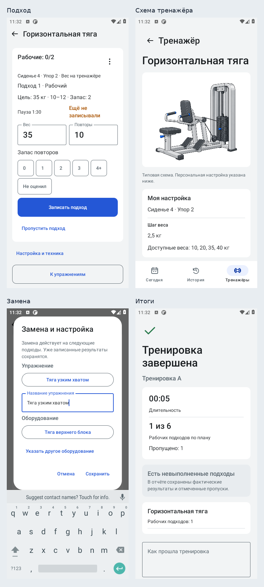

# Итерация пользовательского сценария — 0.2.1

Изменения находятся в прежней ветке `codex/production-workout-flow`, [PR42](https://github.com/bimjim225-ship-it/sportzal/pull/42). Слияние не выполнялось. Все замечания аудита, относящиеся к этой итерации приложения, закрыты; следующий этап — проверка на личном телефоне.

## Что изменилось

| Область | Результат |
|---|---|
| Повтор записи после ошибки | Используются текущие видимые значения и прежний ID попытки. При неизвестном результате сначала проверяется сохранённый факт, включая повторный сбой самого согласования. Дубль не создаётся. |
| Ошибка чтения после записи | Записанное изменение не считается потерянным. Экран предлагает обновить сохранённые данные; диалоги освобождают доступ к восстановлению. |
| Следующий план | Ссылки на существующий каталог принимаются без повторного `equipment_upserts`. Предпросмотр показывает понятные названия. Сохранённая старая версия активируется отдельной кнопкой. |
| Замена | Можно выбрать любой тренажёр зала или указать новый, заменить само движение и его название. Факт, история и отчёт хранят замену отдельно от исходного плана. Несовместимые вес и оценка запаса очищаются; при смене движения очищаются повторы. |
| Каталог | Новое оборудование из факта сохраняется в той же транзакции. Ранее созданные ссылки на отсутствующий тренажёр восстанавливаются в каталоге и экспорте. |
| Пропуски | «Пропустить оставшиеся подходы» атомарно закрывает только свободные слоты текущего упражнения. Записанные результаты остаются; отдельный пропуск можно вернуть. |
| Экран подхода | Поля, запас повторов и запись идут перед схемами и историей. На 360×800 основное действие видно без прокрутки. Старые строки свёрнуты; ошибки находятся у ввода и записи. Дробный ввод сохраняет запятую. |
| Обзор и время | После замены показывается фактическое движение, старый вес не выдаётся за нагрузку нового тренажёра. В rotation-обзоре сохранён таймер. При потере монотонных часов время отмечается «≈»; после часа показываются часы. |
| Обмен с ИИ | В приложении есть пошаговая помощь и готовый копируемый запрос с точной JSON Schema. «Передать отчёт ИИ» / «Сохранить файл» доступны на «Сегодня», итогах и в истории с единым состоянием подготовки. |
| Дополнительные подходы | Исправление неизвестной попытки переносит также тип work/warmup, сохраняя ID, время и порядок. Тип планового слота остаётся неизменным. |

## Проверки

[Android CI98](https://github.com/bimjim225-ship-it/sportzal/actions/runs/40315344607), код `6c77e703ad343a1907ba9c2a025d5824eb96b57e`:

- 123/123 модульных теста.
- 86/86 нативных тестов на API30 / Android 11; 86/86 на API35 / Android 15, без пропусков.
- Сборка приложения и test APK; Android lint — 0 ошибок; предупреждения остаются.
- Контракты документации: 2 схемы, 6 допустимых примеров, 25 отклонённых случаев; ссылки, YAML и 9 пар контраста.
- Графика: 25 WebP и 24 VectorDrawable соответствуют пакету; Room schemas не изменились.

Нативный сквозной сценарий: первый запуск → помощь и копирование запроса → план → начало → выбор упражнения → проверка ошибки у формы → схема/техника → замена движения и выбор тренажёра вне программы → запись 20,5 кг × 12 → пропуск остатка → импорт следующей версии во время занятия → сохранность активного snapshot → досрочное завершение → история → каталог и персональная настройка.

Отдельно проверены сфокусированный экран шириной 320dp, шрифт 200%, 40 записанных подходов и отступы IME. Это автоматическая проверка доступности элементов, а не ручная приёмка TalkBack.

Независимое ревью выявило четыре существенных случая; все исправлены и покрыты регрессиями. Ошибки повторного согласования, смены типа extra, заблокированных модальных окон и неверного обзора после замены воспроизведены до проверки исправлений.

## Скриншоты

Реальные снимки Android 11 из CI98, 360×800, демонстрационные данные. Короткая длительность на итогах относится к автоматической проверке. Android 15 также прошёл полный набор; для галереи выбран прогон без системной панели предпросмотра буфера обмена. Содержимое снимков не ретушировалось; сводный лист только размещает оригиналы рядом. [Метаданные и SHA256](screens/iteration2/captures.json).

| Экран | Снимок |
|---|---|
| Первый запуск | [00-onboarding.png](screens/iteration2/00-onboarding.png) |
| Помощь с ИИ | [00-ai-help.png](screens/iteration2/00-ai-help.png) |
| Сегодня | [01-today.png](screens/iteration2/01-today.png) |
| План до начала | [02-plan.png](screens/iteration2/02-plan.png) |
| Обзор занятия | [03-workout.png](screens/iteration2/03-workout.png) |
| Быстрый ввод | [04-entry.png](screens/iteration2/04-entry.png) |
| Схема и настройка | [05-setup.png](screens/iteration2/05-setup.png) |
| Техника | [06-technique.png](screens/iteration2/06-technique.png) |
| Следующий план | [07-import.png](screens/iteration2/07-import.png) |
| Итоги | [08-finish.png](screens/iteration2/08-finish.png) |
| История | [09-history.png](screens/iteration2/09-history.png) |
| Каталог | [10-catalog.png](screens/iteration2/10-catalog.png) |
| Тренажёр | [11-equipment.png](screens/iteration2/11-equipment.png) |
| Замена | [12-replacement.png](screens/iteration2/12-replacement.png) |
| Пропуск остатка | [13-skip-remaining.png](screens/iteration2/13-skip-remaining.png) |
| Ошибка у записи | [14-inline-validation.png](screens/iteration2/14-inline-validation.png) |

## Принятые решения

- Сохранены Room schema3 и публичный JSONv1; фактическое название добавлено как необязательное поле внутреннего контекста и использует существующие колонки факта. Стоимость: дальнейшее расширение публичного формата потребует отдельного контракта.
- Исправление импорта существующего каталога объединено с первыми регрессиями надёжности; замены, ввод и обмен выпущены единым совместимым изменением компонентов. Стоимость: более крупный шаг при поиске ошибки по истории коммитов.
- Старые ссылки на оборудование восстанавливаются без смены ID; если в старом факте нет имени, используется честное общее название. Стоимость: такое оборудование пользователь должен уточнить вручную.
- Таймер rotation-обзора включён в обязательный объём: он нужен для выбора следующего упражнения. Стоимость: дополнительное место в карточке.
- Приёмка интерфейса подтверждалась свежими нативными тестами и снимками. Стоимость: дополнительный цикл проверки вместо заключения только по исходникам.

## Границы готовности

Перед публичным выпуском остаётся ручная приёмка на физическом телефоне: TalkBack, восстановление после настоящего завершения процесса/OEM, отправка в выбранный чат и сохранение через реального файлового провайдера. Биомеханическая корректность иллюстраций не сертифицирована автоматическими тестами. Цена этих границ — необходимость отдельной приёмки устройства и инструкций.

ИИ остаётся внешним чатом. Автоматическая генерация индивидуальных схем из фото предусмотрена отдельным будущим этапом; сейчас используются подготовленные типовые схемы и явная привязка техники. Полная резервная копия и постоянный канал подписанных обновлений не добавлялись; экспорт отчёта не заменяет backup.

Неисправленных существенных замечаний независимого ревью нет. Мелких замечаний, отложенных этой итерацией, нет.
