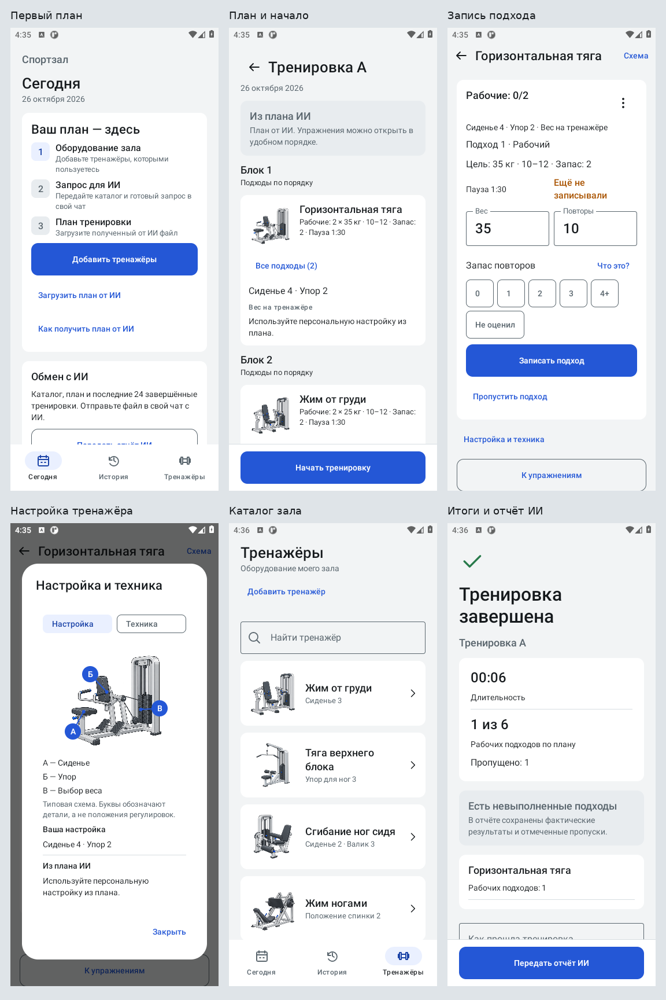

# Sportzal 0.2.2 — понятность и доступность действий

Доработка в [PR43](https://github.com/bimjim225-ship-it/sportzal/pull/43), ветка `codex/ux-clarity`, без слияния. PR42 к началу этой работы уже был merged; новый PR создан от актуального main.

## Результат

| Сценарий | Поведение |
|---|---|
| Первый запуск | Три шага: оборудование → запрос ИИ → файл плана. Главное действие соответствует реальному каталогу. Готовый файл можно загрузить сразу. |
| Длинный план | «Начать тренировку», «Принять план» и «Использовать этот план» доступны в отдельной нижней панели. Содержимое прокручивается выше неё. |
| Итоги | «Передать отчёт ИИ» остаётся доступным при длинном списке результатов. Видимый комментарий сохраняется до отправки; при ошибке отправки со старой заметкой нет. |
| Каталог | Добавление доступно в постоянной шапке. При тесной высоте/крупном шрифте название и описание уходят в ленту, поиск сохраняет свой ключ и ввод. |
| Предпросмотр | Повторяющиеся назначения собраны в сводку. Разные веса, типы, повторы, запас и паузы не выдаются за одну цель; все исходные подходы раскрываются явно. |
| Запас повторов | Общая справка объясняет 0..4+ и «Не оценил». Открытие/закрытие не выбирает оценку. |
| Схемы | Пять типовых схем получили А/Б/В, линии и легенды деталей. Буквы отделены от номеров персональной настройки. Кадры техники показывают последовательность. |
| Быстрый просмотр | «Схема» в шапке упражнения использует фактическое движение и оборудование после замены. В тесном режиме полное название прокручивается с содержимым. |
| Длинная ошибка | В панели действия одна строка со стрелкой раскрытия. Полный текст доступен в прокручиваемом диалоге; поле заметки и отправка не вытесняются. |

Визуальный стиль, офлайн-сценарий и внешний ИИ сохранены. Room schema3 и публичный JSONv1 не менялись. Версия приложения 0.2.2, versionCode4.

## Проверки

Финальный код: `91d2eb636af4c69f12f26fe6c4dc019da5f1fd86`, локальный эквивалент `697ad6d8424ac2e20a47b3bf85a318488d2b8e75`.

[CI106](https://github.com/bimjim225-ship-it/sportzal/actions/runs/40359927966):

- 123/123 JVM-теста.
- 100/100 нативных тестов на API30 / Android 11 и 100/100 на API35 / Android 15. XML обоих прогонов проверены: 0 failures, 0 errors, 0 skipped.
- APK и test APK собраны. Локальная полная сборка/lint также прошли; lint: 0 ошибок, 22 предупреждения.
- Контракты: 2 схемы, 6 допустимых примеров, 25 отклонённых случаев, ссылки/YAML, 9 пар контраста.
- 25 WebP и 24 VectorDrawable соответствуют исходному пакету; Room schemas неизменны.
- Strict UI audit: 0 findings. Это статическая проверка, она не заменяет нативные тесты и осмотр снимков.

Проверены длинные списки/планы, 320dp, шрифт 200%, явные отступы IME, поиск вместе с нижней навигацией, длинное название движения и ошибка сохранения заметки. При проверке нажатий учитывается минимум 48dp внутри доступной области выше IME/навигации; наличие нескольких видимых пикселей не считается достаточным.

Сквозной нативный сценарий включает реальное добавление первого оборудования через форму → подготовку запроса ИИ → план/начало → подход/справку/схему/технику → замену движения и оборудования → запись 20,5 кг × 12 → пропуск остатка → импорт следующей версии без изменения активного snapshot → завершение → историю → все пять схем каталога.

Последний коммит с этим отчётом, планом и снимками не меняет проверенный код приложения, тестов или CI.

## Воспроизведение и независимое ревью

До реализации [CI100](https://github.com/bimjim225-ship-it/sportzal/actions/runs/40348448740) воспроизвёл 10 замечаний интерфейса на обеих версиях Android. После первой реализации [CI101](https://github.com/bimjim225-ship-it/sportzal/actions/runs/40352239869) прошёл 97/97 тестов на каждой.

Одно независимое ревью выявило три риска тесной компоновки. В [CI105](https://github.com/bimjim225-ship-it/sportzal/actions/runs/40358594633) два дефекта подтверждены до исправления: длинная ошибка вытесняла отправку, длинный заголовок оставлял недостаточную область ввода. После одной серии исправлений оба теста проходят в CI106 вместе с полным набором. Проверка каталога на выбранном 320×640dp fixture проходила и до адаптации; её изменение сохранено как предупреждающее улучшение, без заявления о воспроизведённом дефекте.

Проверки стресс-режима были уточнены: сначала измеряется доступная область, затем выполняется прокрутка. Это исключает зависание теста при попытке прокрутить нулевой viewport. Существенных замечаний, оставленных без решения, нет; отложенных мелких замечаний нет.

## Снимки

25 оригинальных нативных снимков из CI106 на Android 11, 360×800, font scale1. Демонстрационные данные; короткая длительность итогов относится к автоматическому сценарию. Android 15 прошёл тот же набор тестов. Снимки не ретушировались; сводный лист только размещает оригиналы и внешние подписи. [Источник и SHA256](screens/ux-clarity/captures.json).

| Экран | Снимок |
|---|---|
| Первый запуск | [00-onboarding.png](screens/ux-clarity/00-onboarding.png) |
| Каталог готов, следующий шаг — ИИ | [15-ai-ready.png](screens/ux-clarity/15-ai-ready.png) |
| Помощь с ИИ | [00-ai-help.png](screens/ux-clarity/00-ai-help.png) |
| Сегодня | [01-today.png](screens/ux-clarity/01-today.png) |
| План и постоянный старт | [02-plan.png](screens/ux-clarity/02-plan.png) |
| Обзор занятия | [03-workout.png](screens/ux-clarity/03-workout.png) |
| Запись подхода | [04-entry.png](screens/ux-clarity/04-entry.png) |
| Ошибка у записи | [14-inline-validation.png](screens/ux-clarity/14-inline-validation.png) |
| Справка запаса повторов | [16-rir-help.png](screens/ux-clarity/16-rir-help.png) |
| Быстрая схема | [17-quick-guide.png](screens/ux-clarity/17-quick-guide.png) |
| Быстрая техника | [18-quick-technique.png](screens/ux-clarity/18-quick-technique.png) |
| Схема под формой | [05-setup.png](screens/ux-clarity/05-setup.png) |
| Техника под формой | [06-technique.png](screens/ux-clarity/06-technique.png) |
| Замена | [12-replacement.png](screens/ux-clarity/12-replacement.png) |
| Пропуск остатка | [13-skip-remaining.png](screens/ux-clarity/13-skip-remaining.png) |
| Следующий план и принятие | [07-import.png](screens/ux-clarity/07-import.png) |
| Итоги и передача отчёта | [08-finish.png](screens/ux-clarity/08-finish.png) |
| История | [09-history.png](screens/ux-clarity/09-history.png) |
| Каталог | [10-catalog.png](screens/ux-clarity/10-catalog.png) |
| Горизонтальная тяга | [11-equipment.png](screens/ux-clarity/11-equipment.png) |
| Персональные настройки | [19-personal-settings.png](screens/ux-clarity/19-personal-settings.png) |
| Жим от груди | [guide-chest_press.png](screens/ux-clarity/guide-chest_press.png) |
| Тяга верхнего блока | [guide-lat_pulldown.png](screens/ux-clarity/guide-lat_pulldown.png) |
| Сгибание ног | [guide-leg_curl.png](screens/ux-clarity/guide-leg_curl.png) |
| Жим ногами | [guide-leg_press.png](screens/ux-clarity/guide-leg_press.png) |

## Решения исполнителя и границы ревью

- Новая ветка/PR от main вместо уже слитого PR42. Цена: отдельная ссылка для проверки; слияние нового PR не выполняется.
- Объём взят из одобренного финального аудита; повторное согласование не запрашивалось. Цена: конкретные решения компоновки оцениваются по этому PR и снимкам.
- Нативные проверки связанных задач выполнялись одним полным набором после наблюдённого RED. Цена: нет отдельного нативного контрольного коммита для одной лишь панели действий.
- ScreenWithAction принимает содержимое без принудительной замены существующего вертикального скроллера итогов на LazyColumn. Цена: каждый экран отвечает за один скроллер своей области.
- Адаптация каталога сохранена предупредительно; выбранный исходный fixture сам по себе не доказывает дефект. Цена: заголовок прокручивается при тесной компоновке.
- Полная длинная ошибка раскрывается отдельно. Цена: одно нажатие для полного текста, при сохранении места для действия и заметки.
- Точный нативный результат и снимки, отложенные независимым ревью, проверены исполнителем по CI106 и SHA256; маркеры осмотрены на пяти схемах при font scale1. Полная визуальная матрица маркеров при увеличении шрифта отдельно не заявляется.
- TalkBack, физический телефон и достижение 3–5 секунд на подход остаются ручной приёмкой. Цена: автоматические проверки не доказывают реальную скорость и удобство одной рукой.
- Схемы сверены с типовыми изображениями, не с конкретной моделью в зале. Цена: персональные настройки остаются текстом, соответствие реальному оборудованию требует проверки владельцем.
- Группировка разминки/рабочих признана корректной: отличия обозначены, исходный порядок раскрывается полностью. Цена: для последовательности различающихся подходов нужно раскрыть карточку.
- Справка RIR остаётся доступной при сохранении: она ничего не записывает. Цена: информационное окно может открыться во время ожидания.
- Вложенный выбор техники использует прежние callbacks сохранения/ошибки; подтверждённого дефекта нет. Цена: отдельный ручной осмотр вложенных окон на телефоне всё ещё полезен.
- Nullable callbacks первого запуска не образуют недоступного шага в production: приложение передаёт оба перехода. Цена: отдельно встроенный компонент требует корректного подключения.
- Чтение, активация и busy импорта сохраняют явные ограничения. Цена: возврат к старому плану требует отдельного подтверждённого действия.
- Форматирование чисел и хранение фактов не менялись; проверки остаются зелёными. Цена: эта итерация не расширяет формат тренировочных данных.
- Небольшие различия точности концов выносок не признаны функциональным дефектом: детали узнаваемы, названия соответствуют изображениям. Цена: выноски не являются инженерным чертежом.

Генерация индивидуальных схем из фото, встроенный LLM/API, полный backup и постоянный канал подписанных обновлений не добавлялись. Перед публичным выпуском остаются реальная тренировка на телефоне, TalkBack, настоящий process death/OEM и передача файла через выбранный чат/файловый провайдер.
